  <picture>
    <source media="(prefers-color-scheme: dark)" srcset="https://raw.githubusercontent.com/tristanchme/tristanchme/main/dark.svg">
    <source media="(prefers-color-scheme: light)" srcset="https://raw.githubusercontent.com/tristanchme/tristanchme/main/light.svg">
    
  </picture>

  <h1>Tristan Chomienne</h1>
  
<strong>Key Account Manager, Large Accounts | Orange Business, Lille</strong>

  
<em>B2B strategic sales · Cybersecurity · Network & SD-WAN · Sovereign cloud</em>

  
  
  

---

## About

Key Account Manager at Orange Business, working on mid-market and large enterprise accounts in the Hauts-de-France region. I sell cybersecurity, SD-WAN/SASE, connectivity and digital transformation solutions to CIOs, IT Directors and CEOs. I qualify opportunities with SPIN Selling and the MEDDIC framework, and I build account plans that link the client's business challenges to a measurable return on investment.

I am completing a Master's degree in High-Tech Business Engineering at Euridis Business School (Lille, 2024–2026) through a work-study contract.

> "I don't sell products. I reduce risk."

---

## Experience

**Key Account Manager, Orange Business** (July 2025 – present, Lille)
Co-management of mid-market and large account subsidiaries, and contribution to high-end accounts alongside my mentor. Co-building proposals and client presentations with the Business Manager, business engineers and pre-sales teams. Reliability of the IT mapping across 70 accounts (cybersecurity, infrastructure, Microsoft, LAN, connectivity, mobility).

**Business Developer, Chrysalides** (August 2024 – July 2025)
Omnichannel business development for mid-sized companies and large enterprises, with a generated pipeline of €250k to €300k. Multichannel B2B prospecting strategy, optimization of the inbound and outbound funnel, and full sales cycle management from prospecting to closing.

**Business Developer, Arclan & Vsens** (August 2023 – November 2024)
Pure new-logo business development in B2G (local government) and healthcare. Signed the company's first sale, an annual €500k contract sourced through outbound. Smarketing and social selling strategy, and responses to tenders with technical specifications.

**Sales Manager, Mas des Bories** (September 2022 – July 2023)
Acquired 27 new B2B clients (gourmet food stores, hotels). Developed and implemented a B2B/B2C strategy and managed key partnerships and customer retention.

**Sales, Ecomagnet** (September 2021 – August 2022)
B2B lead generation and qualification, generating a sales pipeline of approximately €25k. Sales of NFC cards and SEO-optimized websites.

---

## Sales methodology

| Area | Practice |
|---|---|
| Complex B2B sales | SPIN Selling, MEDDIC, negotiation |
| Account strategy | Account plans, decision-maker mapping, ROI framing |
| Prospecting | Outbound cadences, multichannel prospecting, social selling |

## Technical focus

| Area | Topics |
|---|---|
| Security | Zero Trust, SOC/XDR, next-generation firewalls, SIEM, MITRE ATT&CK |
| Network | SD-WAN, SASE, MPLS, network visibility |
| Cloud | Sovereign cloud, SecNumCloud, Microsoft & Azure |
| AI & automation | Open-source AI models, n8n workflows, AI agents |

## Certifications

* Google AI Essentials (Google, September 2026)
* AI Automation Foundations (Skool, June 2026)

## Languages

* French: native
* English: C1 (working proficiency)

---

## Projects

**DigitalGarden: personal knowledge base**
A structured Obsidian vault built on the Zettelkasten method (atomic notes, linked concepts). Used to prepare client meetings, structure MEDDIC qualification and capture sector knowledge. Stack: Obsidian, Git, GitHub.

**Hermes Agent: personal executive assistant**
A self-hosted AI assistant on a Linux server, with scheduled jobs, automated backups and integrations with Telegram, Google Calendar and MCP. Focus on data sovereignty (open-source models, GDPR).

**Cybersecurity watch notes**
Continuous notes on Zero Trust, MITRE ATT&CK, incident response, OWASP and SOC/XDR, turned into actionable material for client discussions.

---

## Contact

* Email: tristanchomienne13@gmail.com
* LinkedIn: [linkedin.com/in/tristanchomienne](https://www.linkedin.com/in/tristanchomienne)
